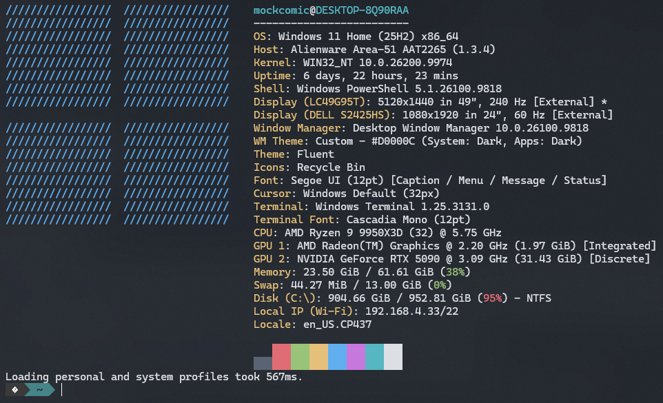

# Terminal Setup Backup — Windows

A complete, portable snapshot of this PC's terminal environment (taken 2026-10-26).
Copy this whole folder to any Windows 10/11 machine (zip it, push it to a GitHub repo, USB stick…)
and run one script to get the identical setup.



## What the setup is

| Component | Detail |
|---|---|
| Terminal | **Windows Terminal** (stable, winget) — currently at default UI settings; settings stored in registry-hive mode (`settings.dat`) |
| Shell | **PowerShell 7** (`pwsh`) as the interactive shell, plus the same profile for Windows PowerShell 5.1 |
| Prompt | **Oh My Posh** with the built-in `gruvbox` theme |
| History | **Atuin** (Ctrl+R search) + PSReadLine history/ListView predictions, Up/Down = history search, Ctrl+Right = accept suggestion, Tab = MenuComplete |
| Navigation | **zoxide** (`z` / `zi`), `cd` auto-lists with **eza**, `cdf`/`openfdir`/`codefdir` via **fzf + fd** |
| Replacements | `ls`/`ll`/`la`/`lt` → **eza** (icons+git), `cat` → **bat**, `grep` → **ripgrep**, `find` → **fd**, `ff` → **fastfetch** (runs on shell start) |
| Git diffs | **delta** as `core.pager` (side-by-side, navigate) + `zdiff3` conflict style, **lazygit** |
| TUIs / extras | **yazi** (file manager, with `file.exe` MIME helper from Git for Windows), **nano**, **glazewm** (window manager), **mise** (tool manager) |
| Handy profile functions | `download <url> [name]`, `emptytrash`, `deepseek` / `deepseek-update` (DeepSeek Harness launcher; repo path is now `$HOME\AI\deepseek-harness`) |
| Fonts | Full **Meslo LG Nerd Font** family (Mono/Propo, L/LDZ/MDZ/M/S) — 72 faces, required for eza icons & prompt glyphs |

## Folder contents

```
terminal-backup/
├── install.ps1                  ← run this on the new PC
├── omarchy-windows-hotkeys.ahk  ← optional AutoHotkey v2 Super-key hotkeys (not installed by install.ps1)
├── winget/
│   ├── terminal-packages.txt    ← curated tool list the installer uses
│   └── full-machine-export.json ← full `winget export` of this PC (reference only; ~100 app IDs)
├── pwsh/
│   ├── pwsh7.Microsoft.PowerShell_profile.ps1
│   ├── ps5.1.Microsoft.PowerShell_profile.ps1
│   └── legacy.WindowsPowerShell.CurrentUserAllHosts.profile.ps1  ← older 5.1 all-hosts profile, archived for reference (never installed)
├── atuin/config.toml
├── git/gitconfig
├── fonts/                       ← 72 Meslo LG Nerd Font faces (.ttf)
└── windows-terminal/
    ├── settings.dat             ← raw WT settings hive backup (currently default settings)
    └── default-profile.txt
```

## Install on another machine

```powershell
cd terminal-backup
powershell -ExecutionPolicy Bypass -File install.ps1
```

The script starts with a menu:

- **[1] Install** — set this PC up from the backup. Saves a backup of the
  machine's current configs first, so the install itself is reversible.
- **[2] Backup** — save the PC's current terminal configs without changing anything.
- **[3] Restore** — pick a saved backup and put its configs back (a backup of
  the present state is saved first, so restore is itself reversible).

Backups live in `%LOCALAPPDATA%\terminal-setup\backups\<timestamp>\` (outside
the repo folder, so re-cloning never deletes your rollbacks). The pre-install
backup can be skipped with `-SkipBackup`.

Flags: `-Install` / `-Backup` / `-Restore` (skip the menu), `-SkipPackages`
(configs only, no winget), `-SkipFonts`.

The installer is idempotent; any file it replaces is additionally saved as
`<file>.bak-<timestamp>` in place.
A `.gitconfig` that already carries a `[user]` identity is **merged, not
replaced**: the delta/LFS settings come from this backup and your name/email
survive re-runs (they were previously wiped by a whole-file replace — which
broke the README's own "set your identity, then re-run for Windows Terminal"
order).
It also moves any *current-user, all-hosts* profile (`Documents\PowerShell\profile.ps1`,
`Documents\WindowsPowerShell\profile.ps1`) out of the way, because those load **before** the
host-specific profiles from this repo and would otherwise run a second oh-my-posh + fastfetch startup.

### Troubleshooting

**The fastfetch banner prints twice.** PowerShell dot-sources up to four profiles, in this order:
`AllUsersAllHosts` → `CurrentUserAllHosts` → `AllUsersCurrentHost` → `CurrentUserCurrentHost`
(`$PROFILE` lists all four paths). Two of them printing a banner = two banners. Current-user files
live in `Documents\PowerShell\` (pwsh 7) and `Documents\WindowsPowerShell\` (5.1); machine-level
files live in the PowerShell install folder and need admin to change. Since `install.ps1` now
disables leftovers at the all-hosts paths, re-running it fixes this.

### Manual steps afterwards (2 minutes)

1. **Launch Windows Terminal once** (first run creates its Settings folder). If you launched WT *before*
   running the installer, settings.dat is applied automatically; otherwise re-run `install.ps1` once.
2. In Windows Terminal **Settings → Startup → Default profile**, pick **PowerShell** (the `pwsh` profile),
   and set its font face to **MesloLGS Nerd Font Mono** (or any bundled Meslo NF) if icons look broken.
3. Re-run `install.ps1` if you had to do step 1 — or sign out/in once if fonts don't appear immediately.
4. **Set your git identity** if this box has none yet — the backup intentionally
   contains no `[user]` name/email (kept off GitHub):
   `git config --global user.name "Your Name"` and `git config --global user.email you@example.com`.
   Re-running `install.ps1` afterwards keeps your identity (it merges instead of replacing).

### Optional: AutoHotkey hotkeys

`omarchy-windows-hotkeys.ahk` is a Super-key (Win) keymap in the Omarchy style —
launcher, workspace switching, gaming-mode toggle, Brave app shortcuts. It is *not*
installed by `install.ps1`: install [AutoHotkey v2](https://www.autohotkey.com/) and
add the file to your Startup folder if you want it. It assumes glazewm is **not**
running (the two overlap on Super-key bindings).

### Restoring a previous state

`install.ps1 -Restore` lists every saved backup with its timestamp and files
and rolls the configs back to the one you pick. The backup folder is also a
good place to fish a single file out of (`%LOCALAPPDATA%\terminal-setup\backups\`),
even if you do not run a full restore. In-place `.bak-<timestamp>` copies are the
second safety net.

### Not restored automatically (by design)

- **Terminal history contents** — Atuin syncs from your Atuin account (`atuin account import` / login), or accept a fresh history.
- Non-terminal winget apps — see `winget/full-machine-export.json` if you ever want everything (`winget import -i winget\full-machine-export.json`).
- Dev-tool PATH entries unrelated to the terminal (pnpm, Python, CUDA, …). Everything in the tool list puts
  itself on PATH through its winget installer (WinGet\Links + package folders).

## Re-taking the backup

After changing anything (new alias, new tool, WT settings):

```powershell
# 1. refresh the pieces you changed, e.g.:
Copy-Item $PROFILE .\pwsh\pwsh7.Microsoft.PowerShell_profile.ps1 -Force
Copy-Item $HOME\.config\atuin\config.toml .\atuin\config.toml -Force
Copy-Item $HOME\.gitconfig .\git\gitconfig -Force
# 2. refresh the full export if you installed more tools:
winget export -o .\winget\full-machine-export.json --include-versions
# 3. add any new tool ID to winget\terminal-packages.txt
```

If you ever give Windows Terminal real custom settings (colorscheme, profiles…) and want them backed up,
either switch WT back to `settings.json` storage (Settings page bottom: "Edit settings in JSON" / storage-mode
toggle) and copy that file into `windows-terminal\`, or add the new `settings.dat` here again.
